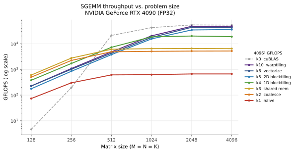
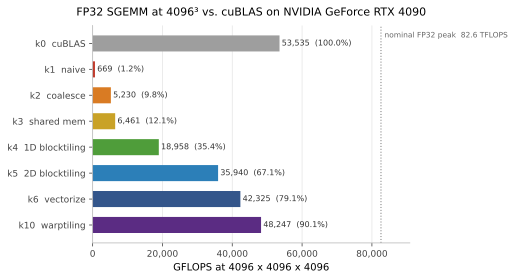

# SGEMM from Scratch: A Step-by-Step CUDA Optimization Study

**English** | [中文](README.zh.md)

<p>
  <a href="LICENSE"></a>
  
  
  
  
</p>

A single-precision matrix multiplication (SGEMM) kernel taken from a naive
implementation to **90.1% of cuBLAS FP32 throughput** on an NVIDIA RTX 4090,
through seven progressively optimized kernels. Each step introduces exactly one
idea — memory coalescing, shared-memory blocking, register blocking,
vectorization, warp tiling — and each step is measured, not estimated.

```
72.2× faster than the naive baseline
```

## Results

Measured on an RTX 4090 at 4096 × 4096 × 4096, FP32. Every number in this
repository was produced by the benchmark harness in this repository on the
hardware listed below.





### Throughput (GFLOPS)

Each cell is the median of three full passes. Most cells vary by less than 1%
between passes; the noisiest (k10 at 4096³) varies by 4.4%.

| kernel | 128 | 256 | 512 | 1024 | 2048 | 4096 |
| --- | ---: | ---: | ---: | ---: | ---: | ---: |
| k0 cuBLAS | 4.6 | 196.0 | 21174.8 | 42661.9 | 54333.9 | 53535.1 |
| k1 naive | 73.5 | 301.4 | 613.1 | 626.1 | 668.0 | 668.7 |
| k2 coalesce | 500.6 | 2243.8 | 4893.0 | 5068.9 | 5189.6 | 5230.5 |
| k3 shared mem | 604.6 | 2773.0 | 6122.5 | 6480.4 | 6556.1 | 6461.4 |
| k4 1D blocktiling | 379.2 | 1710.2 | 7298.5 | 18663.5 | 20074.6 | 18958.3 |
| k5 2D blocktiling | 176.9 | 847.6 | 3783.1 | 15530.7 | 34621.0 | 35940.0 |
| k6 vectorize | 226.3 | 1017.0 | 4299.1 | 17688.6 | 43898.8 | 42325.1 |
| k10 warptiling | 226.2 | 1085.7 | 4834.8 | 20429.4 | 48113.6 | **48247.3** |

### Summary at 4096³

| kernel | GFLOPS | vs. cuBLAS | vs. nominal peak | Time / call | Speed-up over previous |
| --- | ---: | ---: | ---: | ---: | ---: |
| k0 cuBLAS | 53535.1 | 100.0% | 64.8% | 2.57 ms | — |
| k1 naive | 668.7 | 1.2% | 0.8% | 205.5 ms | — |
| k2 coalesce | 5230.5 | 9.8% | 6.3% | 26.3 ms | 7.82× |
| k3 shared mem | 6461.4 | 12.1% | 7.8% | 21.3 ms | 1.24× |
| k4 1D blocktiling | 18958.3 | 35.4% | 23.0% | 7.25 ms | 2.93× |
| k5 2D blocktiling | 35940.0 | 67.1% | 43.5% | 3.82 ms | 1.90× |
| k6 vectorize | 42325.1 | 79.1% | 51.2% | 3.25 ms | 1.18× |
| k10 warptiling | 48247.3 | 90.1% | 58.4% | 2.85 ms | 1.14× |

`vs. nominal peak` uses 82.6 TFLOPS, the RTX 4090 FP32 peak at its 2.52 GHz
reference boost clock (128 SM × 128 lanes × 2 FLOP).

**Reading the table.** The two ends of the size range tell different stories.
At 128³ the fastest kernel is k3, because every kernel is dominated by launch
and start-up overhead and the tiling optimizations have nothing to work on. At
4096³ the ranking inverts and k10 wins by a wide margin. Any claim about "the
fastest kernel" is meaningless without the problem size attached.

## Test platform

| | |
| --- | --- |
| GPU | **NVIDIA GeForce RTX 4090** (AD102, `sm_89`), 128 SMs, 24 GB GDDR6X |
| Driver / CUDA | 570.124.06 / 12.8 (`nvcc` V12.8.61) |
| CPU | Intel Xeon Platinum 8358P @ 2.60 GHz, 128 threads |
| OS | Ubuntu 22.04 container, Linux 5.4.0-100-generic |
| Toolchain | `cmake` 3.31.4, `gcc` 13.3.0, built for `sm_89` |

## Optimization walkthrough

Each kernel changes one thing. Speed-ups below are measured at 4096³.

### k1 → k2 · Coalesced global memory access · **7.82×**

k1 maps `x = threadIdx.x` to matrix rows, so the 32 lanes of a warp read 32
different rows of A, `K × 4 B` apart. One load becomes 32 separate 32-byte
transactions, wasting roughly 7/8 of each cache line.

k2 flattens the block and lets each warp span consecutive columns of B while
broadcasting A. The arithmetic is identical; only the address pattern changed,
and throughput rose 7.82×. This is the clearest demonstration in the project
that GPU performance is decided by memory access before anything else.

### k2 → k3 · Shared-memory blocking · **1.24×**

Each block stages 32 × 32 tiles of A and B into shared memory and reuses them
across the block. The gain is modest because k2's redundant reads were already
largely absorbed by L1/L2, and because a 32 × 32 tile only reaches an arithmetic
intensity of 8 FLOP/B — far below this card's balance point.

### k3 → k4 · 1D register blocking · **2.93×**

Each thread now computes a column of 8 output elements, so one value of B feeds
8 FMAs. The shared-memory-load to FMA ratio drops from 2.0 to 1.125. This is the
first genuine register-level optimization: data moves one level closer to the
compute units.

### k4 → k5 · 2D register blocking · **1.90×**

The 8 × 1 column becomes an 8 × 8 tile. Each inner step loads 16 operands and
issues 64 FMAs, cutting the load/FMA ratio to 0.25 and reusing both A and B.

The gain is smaller than the 4.5× drop in shared-memory loads, which is Amdahl's
law in practice: only the load path was optimized while register pressure rose
to roughly 90 registers per thread.

### k5 → k6 · Vectorized loads · **1.18×**

`float4` loads collapse four scalar loads into one 128-bit instruction, and A is
transposed in shared memory so its reads can also use `LDS.128`.

Worth noting that vectorization is a late-stage optimization. FMA count and
shared-memory bandwidth are unchanged; only instruction count falls, so it pays
off only once the kernel is already compute-dense.

### k6 → k10 · Warp tiling · **1.14×**

Warp is now an explicit level of the hierarchy: 128 threads form 4 warps, each
owning a 64 × 64 sub-tile of C, each thread accumulating 128 results.

Occupancy drops to 17–25%, yet performance peaks. With 128 independent FMAs per
thread the pipeline stays full without needing more warps — instruction-level
parallelism substitutes for thread-level parallelism. Occupancy is a means, not
a goal.

## Build and run

```bash
make build                 # configure + build for sm_89
make run KERNEL=10         # sweep all sizes with one kernel
make bench                 # run every kernel (produces the tables above)
make clean
```

Equivalent without `make`:

```bash
export CUDACXX=/usr/local/cuda/bin/nvcc
cmake -S . -B build -DCMAKE_CUDA_COMPILER=$CUDACXX \
      -DCUDA_COMPUTE_CAPABILITY=89 -DCMAKE_BUILD_TYPE=Release
cmake --build build -j
./build/sgemm 10
```

`KERNEL=0` runs cuBLAS; `1 2 3 4 5 6 10` run the hand-written kernels. Each
invocation sweeps 128, 256, 512, 1024, 2048 and 4096, verifying every size
against cuBLAS before timing it.

`CUDA_COMPUTE_CAPABILITY` defaults to 75 and can be overridden for any
architecture — building for an older target still runs via PTX JIT, but then the
kernel being measured is not the one the driver would choose natively.

## Repository layout

```
cuda-info/
├── sgemm.cu                  # driver: kernel selection, allocation, verification, timing
├── Makefile                  # build / run / bench / clean / submit
├── CMakeLists.txt            # architecture overridable via -DCUDA_COMPUTE_CAPABILITY
├── src/
│   ├── runner.cu             # launch configuration, helpers, run_kernel dispatch
│   ├── runner.cuh
│   ├── kernels.cuh
│   └── kernels/              # one header per optimization stage
├── results/rtx4090.json      # the measurements the figures and tables are generated from
├── scripts/plot_results.py   # regenerates every figure from that JSON
└── figs/                     # generated SVG/PNG
```

Kernel numbering follows the source worklog: k7/k8 were attempts at removing
shared-memory bank conflicts (the conflicts disappeared, the kernels got slower),
k9 was autotuning, and k10 is warp tiling. The gap from 6 to 10 is kept so the
numbering matches the reference material.

## Measurement methodology

| | |
| --- | --- |
| Timing | `cudaEvent` around 50 kernel launches |
| Repetitions | 50 per size, median of 3 full passes |
| Sizes | 128, 256, 512, 1024, 2048, 4096 |
| `alpha` / `beta` | 0.5 / 3.0 |
| Reference | cuBLAS FP32 |
| FLOPs | `2 · M · N · K` |
| Correctness | absolute error < 0.01 against cuBLAS |

The measurements were taken on an idle GPU: 0% utilization, 210 MHz core clock,
14–17 W board power, 39 °C, with no competing compute processes.

### Known limitations

These are properties of the harness, stated plainly because they bound what the
table above can be used to claim:

1. **`beta = 3.0` with no reset of C inside the timing loop.** Each iteration
   computes `C = αAB + 3C`, so after 50 iterations the values have grown by
   `3^50 ≈ 7.2 × 10^23`. The instruction count is unchanged so the timing remains
   meaningful, but resetting C between iterations (or using `beta = 0`) is the
   correct methodology.
2. **A fixed absolute tolerance of 0.01 does not scale with K.** For a
   length-4096 dot product a relative bound, or a double-precision reference,
   would be more defensible.
3. **k5, k6 and k10 have no bounds checking** and require M, N and K to be
   multiples of the tile size. All measured sizes are powers of two, so this does
   not affect the results, but these kernels are not general-purpose.
4. **Small sizes are not representative.** cuBLAS reaches only 4.6 GFLOPS at
   128³, three orders of magnitude below its result at 512³, because a single
   128³ GEMM takes microseconds and 50 launches still total milliseconds — clock
   ramp and launch overhead dominate. Treat the 128 and 256 columns as trend
   indicators only.

## Why 128 × 128 tiles are still memory-bound here

The RTX 4090 has a peak of 82.6 TFLOPS and 1008 GB/s of memory bandwidth, giving
a machine balance of roughly **82 FLOP/B**. A 128 × 128 block tile provides an
arithmetic intensity of about 32 FLOP/B, below that balance point. The fact that
k5/k6/k10 nonetheless reach 67–90% of cuBLAS is largely attributable to the
**72 MB L2 cache**, which absorbs most of the inter-block reuse that the tile
geometry alone cannot.

## Data and reproducibility

`results/rtx4090.json` holds every measurement together with the platform
metadata. `scripts/plot_results.py` regenerates both figures from it:

```bash
python3 scripts/plot_results.py    # requires matplotlib
```

Re-running `make bench` on another GPU and updating that JSON refreshes the
figures and makes the comparison explicit.

## License

[MIT](LICENSE) © 2026 Hanerson

## References

1. Simon Boehm — [How to Optimize a CUDA Matmul Kernel for cuBLAS-like Performance: a Worklog](https://siboehm.com/articles/22/CUDA-MMM)
2. Simon Boehm — [SGEMM_CUDA](https://github.com/siboehm/SGEMM_CUDA)
3. NVIDIA — [CUDA C++ Programming Guide](https://docs.nvidia.com/cuda/cuda-c-programming-guide/)
4. NVIDIA — [CUDA C++ Best Practices Guide](https://docs.nvidia.com/cuda/cuda-c-best-practices-guide/)
5. wangzyon — [NVIDIA_SGEMM_PRACTICE](https://github.com/wangzyon/NVIDIA_SGEMM_PRACTICE) (timing harness)
6. Companion write-up with the full derivation — [SGEMM 优化，从 naive 到 warptiling](https://blog.hanerson.com/2026/10/20/SGEMM-%E4%BC%98%E5%8C%96%E9%95%BF%E5%BE%81%E8%B7%AF/)
