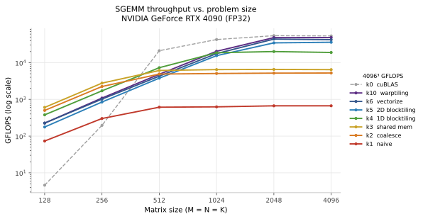
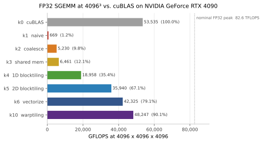

# SGEMM 优化实践：从 naive 到 warptiling

[English](README.md) | **中文**

<p>
  <a href="LICENSE"></a>
  
  
  
  
</p>

一个 FP32 SGEMM（单精度矩阵乘）的渐进优化项目。七个 CUDA kernel 从最朴素的实现出发，
一步步走到接近 cuBLAS 的水平，每一步只引入一个核心思想：合并访存、共享内存分块、
寄存器分块、向量化、warp 分块。

所有性能数据都是在 **NVIDIA GeForce RTX 4090** 上实测得到的，不是估算值，也不是从别处
抄来的参考数字。

```
72.2× faster than the naive baseline
```

## 结果

4096 × 4096 × 4096，FP32。仓库里的每个数字都由本仓库的基准程序在下方列出的硬件上产生。





### 吞吐（GFLOPS）

表中每个格子是 **三轮完整扫描的中位数**。同一格的多轮极差大多在 1% 以内，
少数格子更高（k10 在 4096 维为 4.4%），单轮采样不足以代表真实水平。

| kernel | 128 | 256 | 512 | 1024 | 2048 | 4096 |
| --- | ---: | ---: | ---: | ---: | ---: | ---: |
| k0 cuBLAS | 4.6 | 196.0 | 21174.8 | 42661.9 | 54333.9 | 53535.1 |
| k1 naive | 73.5 | 301.4 | 613.1 | 626.1 | 668.0 | 668.7 |
| k2 coalesce | 500.6 | 2243.8 | 4893.0 | 5068.9 | 5189.6 | 5230.5 |
| k3 shared mem | 604.6 | 2773.0 | 6122.5 | 6480.4 | 6556.1 | 6461.4 |
| k4 1D blocktiling | 379.2 | 1710.2 | 7298.5 | 18663.5 | 20074.6 | 18958.3 |
| k5 2D blocktiling | 176.9 | 847.6 | 3783.1 | 15530.7 | 34621.0 | 35940.0 |
| k6 vectorize | 226.3 | 1017.0 | 4299.1 | 17688.6 | 43898.8 | 42325.1 |
| k10 warptiling | 226.2 | 1085.7 | 4834.8 | 20429.4 | 48113.6 | **48247.3** |

### 4096³ 汇总

| kernel | GFLOPS | 占 cuBLAS | 占标称峰值 | 耗时 | 相对上一级 |
| --- | ---: | ---: | ---: | ---: | ---: |
| k0 cuBLAS | 53535.1 | 100.0% | 64.8% | 2.57 ms | — |
| k1 naive | 668.7 | 1.2% | 0.8% | 205.5 ms | — |
| k2 coalesce | 5230.5 | 9.8% | 6.3% | 26.3 ms | 7.82× |
| k3 shared mem | 6461.4 | 12.1% | 7.8% | 21.3 ms | 1.24× |
| k4 1D blocktiling | 18958.3 | 35.4% | 23.0% | 7.25 ms | 2.93× |
| k5 2D blocktiling | 35940.0 | 67.1% | 43.5% | 3.82 ms | 1.90× |
| k6 vectorize | 42325.1 | 79.1% | 51.2% | 3.25 ms | 1.18× |
| k10 warptiling | 48247.3 | 90.1% | 58.4% | 2.85 ms | 1.14× |

「占标称峰值」按 RTX 4090 FP32 标称 82.6 TFLOPS 计算
（128 SM × 128 lane × 2 FLOP × 2.52 GHz 参考加速频率）。

**怎么读这张表。** 尺寸区间两端讲的是两件事。128³ 时最快的是 k3，因为这个尺寸下所有
kernel 都被启动开销支配，tiling 优化没有发挥空间；到 4096³ 排名反转，k10 大幅领先。
脱离问题规模谈「哪个 kernel 最快」是没有意义的。

## 测试环境

| 项目 | 配置 |
| --- | --- |
| GPU | **NVIDIA GeForce RTX 4090**（AD102，`sm_89`），128 SM，24 GB GDDR6X |
| 驱动 / CUDA | 570.124.06 / 12.8（`nvcc` V12.8.61） |
| 主机 | Intel Xeon Platinum 8358P @ 2.60 GHz，128 线程 |
| 系统 | Ubuntu 22.04 容器，Linux 5.4.0-100-generic |
| 工具链 | `cmake` 3.31.4、`gcc` 13.3.0，按 `sm_89` 编译 |

> 镜像里 `nvcc` 不在 `PATH` 上，`make` 会自动回退到 `/usr/local/cuda/bin/nvcc`，
> 也可以用 `make build NVCC=/path/to/nvcc` 指定。

## 优化路线

每一站只引入一个新思想，下面的倍数来自 4096³ 的实测。

### k1 → k2 · 合并访存 · **7.82×**

k1 把 `threadIdx.x` 映射到行，一个 warp 的 32 个 lane 落在 A 的 32 个不同行上，
地址相差 `K × 4 B`，一次 load 被拆成 32 次 32 字节事务，每条缓存行浪费约 7/8。

k2 把 block 拍平，让每个 warp 沿 B 的连续列走、对 A 做广播。算术完全没变，只是地址
变了，就快了 7.82 倍——这是整个项目里「访存先于计算」最清楚的一次证明。

### k2 → k3 · 共享内存分块 · **1.24×**

每个 block 先把 A、B 的 32 × 32 切片搬进共享内存，在 block 内复用。收益不大，因为 k2
的重复读很多已被 L1/L2 接住，而且 32 × 32 的 tile 算术强度只有 8 FLOP/B，远低于本卡
平衡点。

### k3 → k4 · 1D 寄存器分块 · **2.93×**

每个线程改为计算一列 8 个输出，B 的一个值喂 8 次 FMA，共享内存读与 FMA 的比例从 2.0
降到 1.125。这是第一个真正见效的寄存器级优化：数据又往计算单元靠近了一层。

### k4 → k5 · 2D 寄存器分块 · **1.90×**

8 × 1 的柱子变成 8 × 8 的方阵：每步读 16 个操作数、做 64 次 FMA，读写比降到 0.25，
A 和 B 同时被复用。

但收益小于 4.5 倍的读指令降幅，这是 Amdahl 定律的实践版本——只优化了读这一路，
寄存器压力却升到每线程约 90 个。

### k5 → k6 · 向量化 · **1.18×**

`float4` 把四条标量读取合成一条 128 位指令，并把 A 在共享内存中转置，使其读取也能用
`LDS.128`。

值得强调的是向量化属于后期优化：FMA 数量和共享内存带宽都没变，省下的只是指令条数，
只有在 kernel 已经计算密集时才有意义。

### k6 → k10 · warp 分块 · **1.14×**

warp 成为显式的层次：128 个线程组成 4 个 warp，每个 warp 负责 C 的 64 × 64 子块，
每个线程累加 128 个结果。

occupancy 降到 17%~25%，性能反而最高。每线程 128 个独立 FMA 足以填满流水线，
指令级并行替代了线程级并行——occupancy 是手段，不是目标。

## 编译与运行

```bash
make build                 # 配置并按 sm_89 编译
make run KERNEL=10         # 用单个 kernel 扫描全部尺寸
make bench                 # 跑全部 kernel（产出上表数据）
make clean
```

不用 `make` 的等价写法：

```bash
export CUDACXX=/usr/local/cuda/bin/nvcc
cmake -S . -B build -DCMAKE_CUDA_COMPILER=$CUDACXX \
      -DCUDA_COMPUTE_CAPABILITY=89 -DCMAKE_BUILD_TYPE=Release
cmake --build build -j
./build/sgemm 10
```

`KERNEL=0` 走 cuBLAS，`1 2 3 4 5 6 10` 走自研 kernel。每次运行依次扫描
128、256、512、1024、2048、4096，每个尺寸先与 cuBLAS 校验正确性再计时。

`CUDA_COMPUTE_CAPABILITY` 默认 75，可覆盖成任何架构——编译到较老的架构仍能通过 PTX JIT
运行，但那样测的就不是显卡原生会执行的 kernel 了。

## 目录结构

```
cuda-info/
├── sgemm.cu                  # 主程序：kernel 选择、分配、校验、计时
├── Makefile                  # build / run / bench / clean / submit
├── CMakeLists.txt            # 架构可用 -DCUDA_COMPUTE_CAPABILITY 覆盖
├── src/
│   ├── runner.cu             # launch 配置、工具函数、run_kernel 调度
│   ├── runner.cuh
│   ├── kernels.cuh
│   └── kernels/              # 每个优化阶段一个头文件
├── results/rtx4090.json      # 图表与表格所依据的实测数据
├── scripts/plot_results.py   # 从该 JSON 重新生成全部图表
└── figs/                     # 生成的 SVG/PNG
```

kernel 编号沿用原文顺序：k7/k8 是消 bank conflict 的尝试（conflict 消掉了，kernel 更慢了），
k9 是自动调参，k10 是 warptiling。保留 6 到 10 的跳跃是为了与参考资料对齐。

## 测量口径

| 项目 | 设置 |
| --- | --- |
| 计时方式 | `cudaEvent` 包住 50 次 kernel launch |
| 重复次数 | 每个尺寸 50 次，三次完整扫描取中位数 |
| 尺寸 | 128 / 256 / 512 / 1024 / 2048 / 4096 |
| `alpha` / `beta` | 0.5 / 3.0 |
| 参考实现 | cuBLAS FP32 |
| FLOPs | `2 · M · N · K` |
| 正确性 | 与 cuBLAS 的绝对误差 < 0.01 |

测量时 GPU 空闲：利用率 0%、核心频率 210 MHz、功耗 14~17 W、39 °C，无其他计算任务竞争。

### 已知局限

这些是 harness 自身的性质，明确写出来是因为它们界定了上表可以被用来支持什么结论：

1. **`beta = 3.0`，且计时循环内不重置 C。** 每次迭代执行 `C = αAB + 3C`，50 次后数值
   放大 `3^50 ≈ 7.2 × 10^23`。指令条数不变，计时仍然有效，但正确做法是每次重置 C
   或令 `beta = 0`。
2. **固定绝对误差 0.01 不随 K 缩放。** 对 4096 长度的点积，相对误差界或双精度参考
   更站得住脚。
3. **k5、k6、k10 没有边界检查**，要求 M、N、K 都是 tile 尺寸的整数倍。所有测量尺寸都是
   2 的幂，因此不影响结果，但这几个 kernel 不是通用实现。
4. **小尺寸不代表真实水平。** cuBLAS 在 128³ 只有 4.6 GFLOPS，比 512³ 低三个数量级，
   因为一次 128³ 的 GEMM 只有微秒级，50 次仍然只有毫秒量级，频率爬升和启动开销占主导。
   128、256 两列只能看趋势。

## 为什么 128 × 128 的 tile 在这里仍受限于内存

RTX 4090 标称峰值 82.6 TFLOPS、显存带宽 1008 GB/s，机器平衡点约为 **82 FLOP/B**。
而 128 × 128 的 block tile 只能提供约 32 FLOP/B，低于平衡点。k5/k6/k10 仍能达到
cuBLAS 的 67%~90%，很大程度上归功于 **72 MB 的 L2**，它吸收了 tile 几何本身无法
提供的跨 block 复用。

## 数据与可复现性

`results/rtx4090.json` 保存全部测量值及平台元数据，`scripts/plot_results.py` 由它
重新生成两张图：

```bash
python3 scripts/plot_results.py    # 需要 matplotlib
```

换一张卡重跑 `make bench` 并更新该 JSON，图表会随之刷新，对比也变得更明确。

## 许可

[MIT](LICENSE) © 2026 Hanerson

## 参考

1. Simon Boehm — [How to Optimize a CUDA Matmul Kernel for cuBLAS-like Performance: a Worklog](https://siboehm.com/articles/22/CUDA-MMM)
2. Simon Boehm — [SGEMM_CUDA](https://github.com/siboehm/SGEMM_CUDA)
3. NVIDIA — [CUDA C++ Programming Guide](https://docs.nvidia.com/cuda/cuda-c-programming-guide/)
4. NVIDIA — [CUDA C++ Best Practices Guide](https://docs.nvidia.com/cuda/cuda-c-best-practices-guide/)
5. wangzyon — [NVIDIA_SGEMM_PRACTICE](https://github.com/wangzyon/NVIDIA_SGEMM_PRACTICE)（计时框架来源）
6. 完整推导与逐站讲解 — [SGEMM 优化，从 naive 到 warptiling](https://blog.hanerson.com/2026/10/20/SGEMM-%E4%BC%98%E5%8C%96%E9%95%BF%E5%BE%81%E8%B7%AF/)
